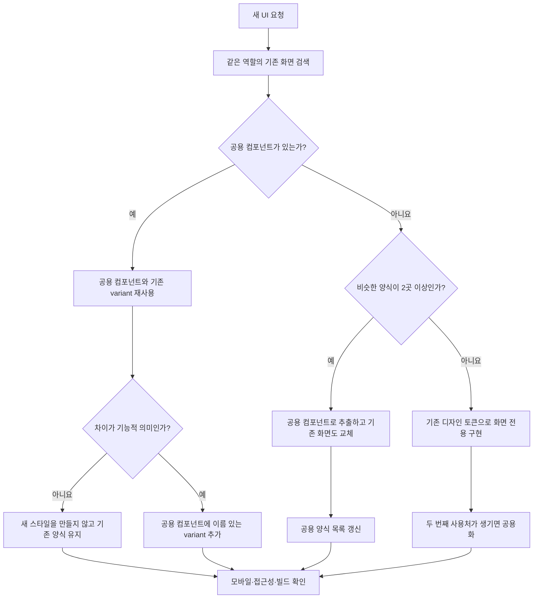

# UI 일관성 규칙

새 화면은 새 스타일을 먼저 만들지 않고, 같은 역할을 하는 기존 화면과 공용 컴포넌트를 먼저 찾는다.

## 공용 양식 목록

| 역할 | 공용 구현 | 사용 원칙 |
| --- | --- | --- |
| 폴더·목록 상세 상단 행 | `FolderDetailHeader` | 뒤로가기, 제목, 편집·동기화 액션은 이 컴포넌트로 통일 |
| 화면/목록 전환, 단일 선택 | `Segmented` | 화면 전환은 `tabs`, 폼 선택은 `single-select` 의미 사용 |
| 색상 선택 | `ColorPicker` | 색상 원형, 선택 테두리, 접근성 역할을 공용 처리 |
| 바텀시트 | `Sheet` | 닫기·스와이프·배경 처리를 개별 구현하지 않음 |
| 드롭다운 | `ThemeSelect` | 브라우저 기본 select 대신 앱 테마 사용 |
| 확인·삭제 확인 | `ConfirmDialog` | `confirm()`을 새로 추가하지 않고 공용 대화상자 사용 |
| 아이콘 | `Icon`, `TypeGlyph` | 같은 의미에는 같은 이름과 선 굵기 사용 |
| 기본 버튼 | `.btn` 변형 | `primary`, `subtle`, `danger` 중 의미에 맞게 선택 |

## 테마 토큰

색은 `styles.css`에 직접 쓰지 않고 토큰으로만 쓴다. 템플릿(밴드·개인·친구…)은 `workspaceTemplates.ts`의 `WorkspaceTheme`만 채우고, 라이트/다크 차이는 `workspaceThemeStyle`이 색상 모드에서 자동으로 만든다. 그래서 새 템플릿이나 새 화면을 만들 때 테마를 따로 맞출 일이 없어야 한다.

`npm run build`가 `scripts/check-theme.cjs`를 먼저 실행해 `styles.css`에 `#hex`·`rgba()` 리터럴이 있으면 실패한다. 사진 위 오버레이처럼 테마와 무관한 고정 색만 같은 줄에 `/* literal-ok: 이유 */`(블록은 `literal-ok-start` … `literal-ok-end`)로 표시한다.

| 역할 | 토큰 | 사용 원칙 |
| --- | --- | --- |
| 주 동작(저장·FAB·채널 추가) | `--accent-gradient` + `--on-accent` + `--accent-shadow` | `.btn.primary`·`.fab`가 기준. 새 주 동작 버튼은 이 셋을 그대로 쓴다 |
| 단색 선택(파트·필터·탭) | `background: var(--accent); color: var(--on-accent); box-shadow: var(--accent-shadow)` | `.part-btn.on`, `.part-chip.on`, `.mine-filter.on` 과 같은 모양 |
| 유형색(`--k`) 선택 칩 | `color-mix(var(--k) var(--selected-fill-mix) …)` + `--selected-border-mix` + `--selected-glow-mix` + `--selected-icon-mix` | 다크=틴트, 라이트=단색으로 자동 분기. `.chip`·`.type-pick`·`.ps-type-opt` 참고 |
| 활성 탭·선택 행 배경 | `--accent-soft` | 하단 내비 `.navitem.on`, 채널 목록 `.active` |
| 포커스 링 | `--accent-ring` | `box-shadow: 0 0 0 3px var(--accent-ring)` |
| 표면 | `--surface` / `--surface-2` / `--surface-active` / `--surface-hover` / `--control-bg` | 카드·칩·입력은 `rgba(255,255,255,.05)` 같은 유리 값 대신 이 토큰. hover는 `--surface-hover` |
| 글자 | `--ink` / `--ink-soft` / `--ink-faint` / `--heading` | 흰색(`#fff`) 금지. 포인트 색 위는 `--on-accent`, 참석 상태색 위는 `--on-status` |
| 그림자·글로우 | `--card-shadow` / `--shadow-sm` / `--glow-color` | 라이트는 카드가 평면(`--card-shadow` 투명)·글로우 없음. `--shadow`·`--shadow-lift`는 시트·모달 전용 |
| 의미색 | `--ok` `--warn` `--info` `--no` `--undecided`, 달력 `--sun` `--sat` | 뱃지·오류·요일에 임의 색 대신 의미색 사용 |
| 오버레이 | `--scrim` | 시트·다이얼로그 배경 |

새 템플릿을 추가할 때는 `WorkspaceTheme`의 필드(accent·accent2·표면·글자·의미색·sun/sat)만 채운다. 다크 계열은 `darkTheme()`, 라이트 계열은 `personalBasedTheme()`를 바탕으로 포인트 색만 바꾼다. 포인트 색이 밝아 흰 글자 대비가 모자라면(친구 템플릿의 탄·세이지) `onAccent`를 진한 색으로 둔다. 보조색(accent2)이 연한 템플릿에서도 뱃지 글자가 읽히도록 뱃지 글자색은 `color-mix(var(--accent-2), var(--ink))`로 섞는다.

## 테두리 중첩 금지

테두리(또는 배경 카드)를 가진 요소를 감싸는 컨테이너에 또 테두리를 두지 않는다. 경계선이 두 겹으로 보여 답답해진다.

- 칩·태그·버튼처럼 **자체 테두리가 있는 항목의 목록**은 라운드 패널로 감싸지 않고 제목 + 항목만 둔다.
- 묶음 표시가 꼭 필요하면 테두리 대신 **여백·소제목·구분선** 중 하나만 쓴다.
- 이미 테두리가 있는 카드 안에 또 카드가 필요하면, 안쪽은 테두리 없이 배경색만으로 구분한다.

예: 투표 관리 시트의 참여자 명단은 칩에 테두리가 있으므로 바깥 패널에 테두리를 두지 않는다.

## 개발 요청 판단 흐름

## 완료 기준

- 390px 안팎 모바일 폭에서 제목과 액션이 겹치지 않는다.
- 클릭 가능한 아이콘은 `aria-label`이 있고 선택형 컨트롤은 상태를 전달한다.
- 색상, 테두리, 간격은 `styles.css`의 기존 변수와 공용 클래스를 쓴다.
- 짧은 액션 버튼 문구는 모바일에서도 줄바꿈하지 않는다. 같은 행의 버튼은 `white-space: nowrap`과 유연한 폭·간격으로 한 줄을 유지한다.
- 기능 확인만으로 끝내지 않고 실제 화면에서 헤더·탭·본문의 좌우 정렬선, 요소 간격, 빈 상태의 중심, 의도하지 않은 줄바꿈을 함께 검토한다.
- 유사한 JSX/CSS가 두 화면 이상이면 복사 전에 공용화 여부를 판단한다.
- `npm run build`가 통과해야 한다.
